# 🧭 Rota — a personal career radar

[](https://github.com/ErickMS18/rota/actions/workflows/tests.yml)


**Rota reads the job market for the roles you want, tells you what you already have and what is
missing, and turns that into a weekly plan that respects more than just your career.**

You pick target roles (e.g. *AI/ML Engineer* and *Data Scientist*). Rota collects real postings
from public job-board APIs, uses an LLM to extract required vs. nice-to-have skills and seniority,
compares them with your resume and produces:

- a **market report** — the most requested skills per role, Brazil vs. international remote, seniority mix and trends over time;
- a **gap analysis** — have / partial / missing, ranked by demand;
- a **focus-weighted study plan** — career, exploration and personal interests each get protected time;
- the **numbers for a LinkedIn post** ("I analyzed N postings for X: the most requested skills are…").

Everything runs locally. Your resume, your profile and the posting texts never leave your machine
except for the redacted text sent to the LLM provider you configure.

> v1 = career analyzer (this release). v2 = personal orchestrator (planned, see [Roadmap](#roadmap)).

---

## How it works

```mermaid
flowchart LR
    subgraph Sources["Public sources (read-only APIs)"]
      GH[Greenhouse]
      LV[Lever]
      ASH[Ashby]
      HM["Himalayas<br/>remote, open to Brazil"]
      IN["inbox/<br/>postings you paste"]
      GP["Gupy<br/>opt-in, off by default"]
    end
    Sources --> N["Normalize · role filter by title regex · dedupe"] --> DB[("SQLite<br/>data/rota.db")]
    DB --> X{Extractor}
    X -->|"LLM (JSON validated, cached)"| C[Canonicalize to a 96-skill taxonomy]
    X -->|dictionary baseline| C
    C --> M["Market analysis<br/>demand = required + 0.5 · nice"]
    CV[Your resume] --> R[Redact PII] --> P["Profile: skill levels 0-3<br/>+ manual overrides"]
    M & P --> G["Gap = demand × (1 − coverage)"]
    G --> PL["Plan: hours split by focus weights<br/>protected exploration · bridges · trade-offs"]
    M & G & PL --> REP["Report · charts · post numbers · Streamlit UI"]
```



**Key design choices**

| Decision | Why |
|---|---|
| Official public job-board APIs, not scraping | Stable JSON, no login, allowed by the providers. LinkedIn and Indeed are excluded because their terms forbid automated collection. |
| LLM output → Pydantic schema → closed taxonomy | Free-text skills ("Py", "python3", "Python 3.x") are mapped to one id, so counting is meaningful. Unknown skills are kept as `other:*` and surfaced as possible emerging topics. |
| Dictionary baseline kept alongside the LLM | Gives the evaluation a reference point and lets the tool work without any API key. |
| Provider-agnostic LLM client (plain HTTP) | Gemini, Anthropic, OpenAI or any OpenAI-compatible endpoint (Ollama for fully local). One `.env` line to switch. |
| Content-hash cache for every LLM call | Re-running costs nothing; only new or changed postings are sent. |
| Focus weights with protected exploration | The plan never declares a project "irrelevant": it shows the trade-off and asks. Interests outside the career get *bridges* (e.g. a hobby-themed project that trains a target skill). |

## Sources and compliance

| Source | Access | Notes |
|---|---|---|
| [Greenhouse Job Board API](https://developers.greenhouse.io/job-board.html) | Public GET, no auth | Configure company board tokens in `config/sources.yaml`. |
| [Lever Postings API](https://github.com/lever/postings-api) | Public GET, no auth | US and EU hosts handled automatically. |
| [Ashby Job Postings API](https://developers.ashbyhq.com/docs/public-job-posting-api) | Public GET, no auth | |
| [Himalayas Remote Jobs API](https://himalayas.app/docs/remote-jobs-api) | Public, free | Remote roles; `country: Brazil` keeps only jobs open to people in Brazil. Attribution is shown in reports; data is not redistributed. |
| Gupy portal search | Undocumented endpoint | **Disabled by default.** Gupy's terms of use forbid aggregating or copying platform content. If you enable it, use it for personal analysis only, keep the slow pace, and publish only aggregate numbers. |
| `inbox/` and the UI form | You paste postings | Anything you found elsewhere. |

All collectors send a descriptive User-Agent, wait between requests to the same host and back off on HTTP 429.
Posting texts are stored only in your local database; the repository and the public report contain only aggregate counts.

## Quickstart (Windows / PowerShell)

```powershell
git clone https://github.com/ErickMS18/rota.git
cd rota
python -m venv .venv
.\.venv\Scripts\Activate.ps1
pip install -e ".[dev]"

rota init                      # creates data/, profile/, reports/ and .env
notepad .env                   # paste ONE LLM key (Gemini has a free tier)

rota boards check              # optional: which configured companies exist / have jobs
rota collect                   # fetch postings for your target roles
rota extract                   # LLM extraction (use --extractor baseline for no-LLM mode)
rota profile C:\path\to\resume.pdf
rota report                    # reports/rota_report.md (private) + charts
rota report --public           # reports/public/ (market only, safe to share)
rota ui                        # local web app
```

macOS/Linux: same commands, activate with `source .venv/bin/activate`.

### Configuration

| File | What it controls |
|---|---|
| `config/targets.yaml` | Target roles: title regexes, search terms, seniority you are aiming for. |
| `config/sources.yaml` | Which sources are on and which companies (boards) to read. |
| `config/focus.yaml` | Weekly hours, focus weights (career / exploration / interests), exploration topics, interests. |
| `.env` | `LLM_PROVIDER`, `LLM_MODEL` and the key. Never committed. |
| `profile/overrides.yaml` | Your manual corrections to skill levels (also editable in the UI). |

## Evaluation

Extraction quality is measured against a hand-labeled gold set of **real postings** sampled from
actual collections (stratified by role and language, at most 3 per company). Labels follow
[eval/GUIDELINES.md](eval/GUIDELINES.md); the metric is micro precision/recall/F1 over
`(posting, skill)` pairs in the closed taxonomy, with a 95% bootstrap confidence interval over postings.
"F1 incl. required/nice" only counts a hit if the requirement level also matches.

**How the gold set was built (read before trusting the numbers):**
- 40 postings drawn by `rota eval sample` (seed 42) from a real collection on 2026-11-21: 20 AI/ML Engineer + 20 Data Scientist; 20 in English and 20 detected as Portuguese (one of them is in Spanish).
- The skill taxonomy was frozen *before* labeling and has not been tuned on these postings.
- Labels were drafted by an AI assistant (Claude) following the guidelines, without seeing any extractor output, and are marked `pending human review` in `eval/gold.jsonl`. A human review pass is planned; results will be re-run after it.
- Scoring is closed-vocabulary, which favors the dictionary baseline (it can only ever predict taxonomy skills). The LLM's advantage shows up in skills that are described rather than named ("communicate clearly", "monitor models in production").

<!-- EVAL:START -->
Gold set: **40 real job postings** (20 AI/ML Engineer (LLM/GenAI), 20 Data Scientist; 20 EN, 20 PT), labeled with 618 skill labels from a 96-skill taxonomy. Evaluated on 2026-11-21.

| Extractor | Skill P | Skill R | Skill F1 (95% CI) | F1 incl. required/nice | Seniority acc. | Unmapped |
|---|---:|---:|---:|---:|---:|---:|
| Dictionary baseline | 0.92 | 0.80 | **0.85** (0.83–0.88) | 0.77 | 0.90 | 0% |
| LLM (gemini/gemini-3.5-flash-lite) | 0.98 | 0.75 | **0.85** (0.82–0.88) | 0.81 | 1.00 | 1% |

Skill F1 by posting language:

| Extractor | EN (n=20) | PT (n=20) |
|---|---:|---:|
| Dictionary baseline | 0.83 | 0.88 |
| LLM (gemini/gemini-3.5-flash-lite) | 0.84 | 0.87 |
<!-- EVAL:END -->

Reproduce:

```powershell
rota eval fetch                 # re-downloads the gold postings that are still online
rota eval run --update-readme   # baseline + LLM, writes eval/RESULTS.md and eval/results/*.json
```

The repository contains only labels and posting ids/URLs (`eval/gold.jsonl`), never the posting texts.

## Privacy

- `.env`, `data/`, `profile/`, `reports/` and `inbox/*` are git-ignored, and
  `tests/test_eval_privacy.py` fails if any of them stops being ignored or gets tracked.
- Before your resume goes to the LLM, the first line (name), e-mails, phone numbers, links and document
  numbers are removed (`profile/resume_redacted.txt` shows exactly what was sent). `rota profile --no-llm`
  sends nothing.
- On free LLM tiers the provider may use requests to improve its products; use a paid key or a local model
  (`LLM_PROVIDER=openai_compatible` + Ollama) if that matters to you.

## Project layout

```
src/rota/
  sources/        Greenhouse, Lever, Ashby, Himalayas, Gupy, manual inbox
  llm/            provider-agnostic JSON client (retries, throttling, cache)
  extract/        LLM prompt + dictionary baseline + canonicalization
  analysis/       market stats, gap, focus-weighted plan
  report/         Markdown report, charts, LinkedIn numbers
  eval/           sampling, metrics, bootstrap CI
  ui/app.py       Streamlit app
  resources/      skills taxonomy, project templates, report template
tests/            offline tests with a fake network (pytest)
```

## Limitations

- Coverage depends on which companies you list; Greenhouse/Lever/Ashby skew toward tech companies.
  Many Brazilian companies hire through Gupy, which is off by default for the reason above.
- Shares are computed per posting, not per hire; one company with many similar openings can tilt the numbers.
- Trends compare postings by publication date and need at least 10 recent and 10 older postings; collecting regularly builds that history.
- Skill effort estimates in the plan are rough defaults per skill (`skills.yaml`), meant for ordering, not promises.

## Roadmap

**v2 — personal orchestrator.** Takes the v1 plan plus current projects (college, internship, research,
personal) with deadlines; builds and adjusts the week and the day ("what now", daily goal) and re-plans
when something slips — keeping the same focus weights and protected exploration.

## License

MIT — see [LICENSE](LICENSE). Job data belongs to the respective employers and job boards.
