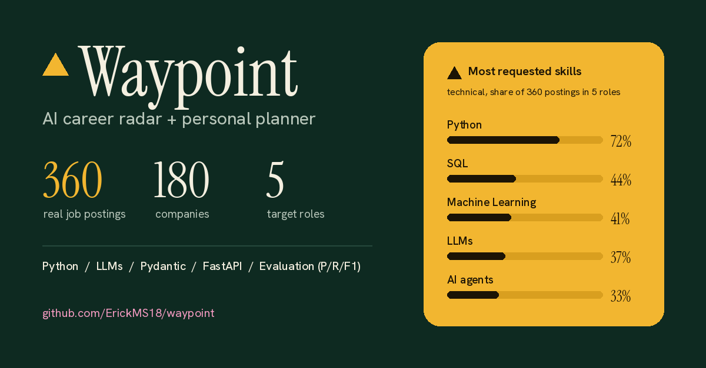
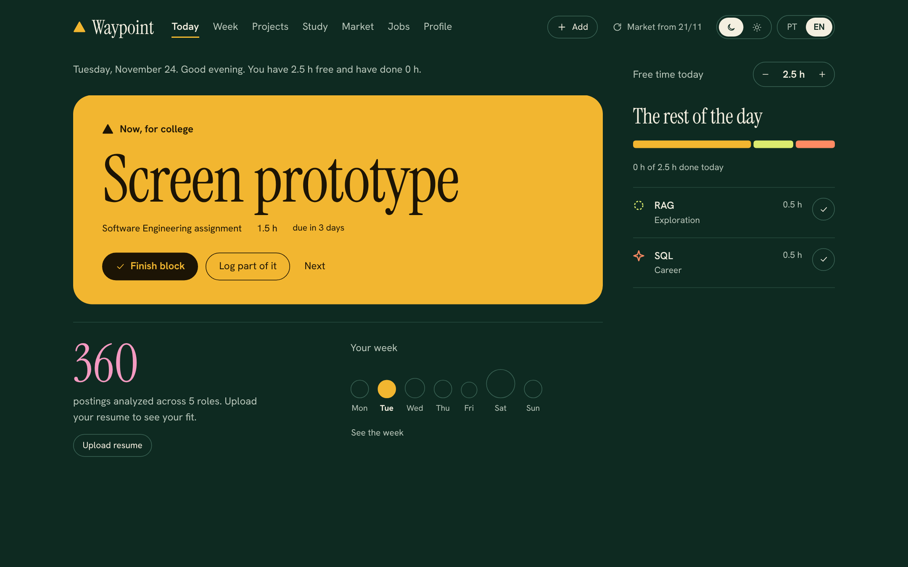
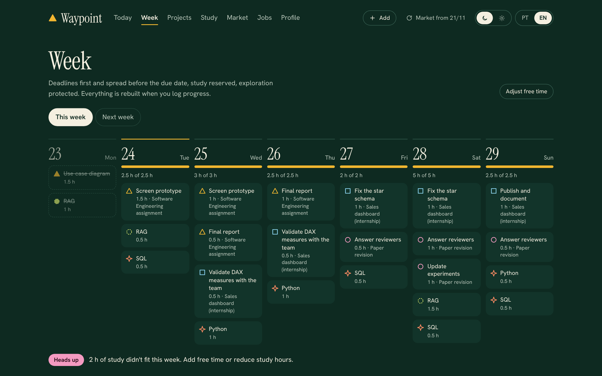
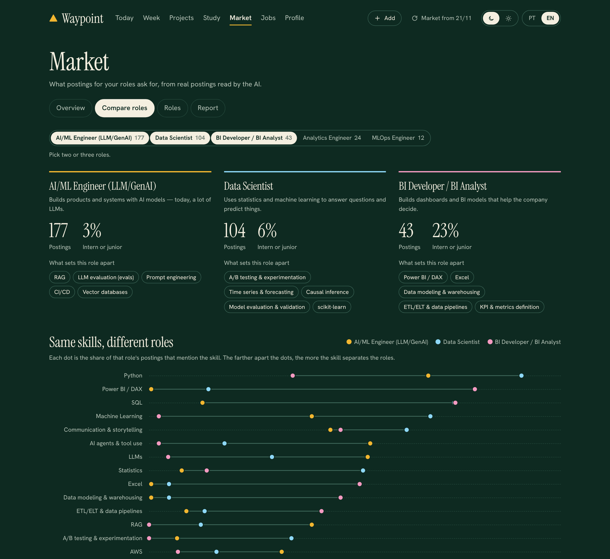
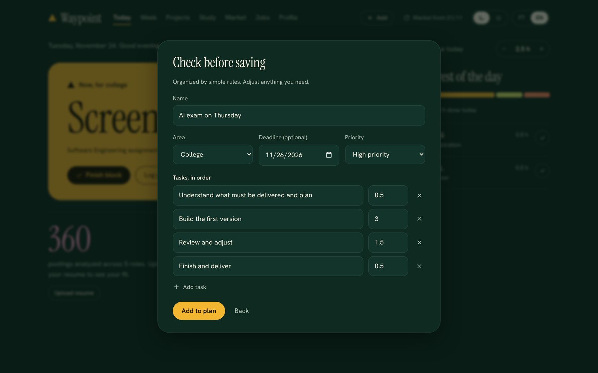

<p align="center"></p>

# Waypoint — an LLM-powered career radar and personal planner

[](https://github.com/ErickMS18/waypoint/actions/workflows/tests.yml)


**Waypoint answers two questions with real data: _"what does the market actually ask for in the roles I want,
and what am I missing?"_ and _"given my classes, internship, research and deadlines, what should I do right now?"_**

- **v1 — career radar.** Collects real job postings from public job-board APIs, uses an LLM to turn each posting into
  structured data (skills, required vs. nice-to-have, seniority), compares the market with your resume and builds a study plan.
  Extraction quality is measured against a labeled gold set, and the numbers are in this README.
- **v2 — personal orchestrator.** Combines that study plan with your projects and deadlines into a schedule for the week
  and a single "do this now" for today, and re-plans automatically when something slips.

> I built it for my own job search (AI/ML Engineer, Data Scientist, BI/Analytics Engineer, MLOps), and I use it every week.

## What it found (snapshot, Nov 2026)

**360 postings · 180 companies · 5 roles · Brazil + remote-friendly international** (one click refreshes them):

| Role | Postings | Most requested skills (share of postings) |
|---|---:|---|
| AI/ML Engineer (LLM/GenAI) | 177 | Python 68% · AI agents & tool use 54% · LLMs 53% · Machine Learning 40% · RAG 40% |
| Data Scientist | 104 | Python 90% · SQL 74% · Machine Learning 68% · Statistics 52% · A/B testing 35% |
| BI Developer / BI Analyst | 43 | Power BI/DAX 79% · SQL 74% · Excel 51% · Data modeling 47% · ETL/ELT 42% |
| Analytics Engineer | 24 | SQL 100% · Python 79% · dbt 71% · Data modeling 54% · Tableau/Looker 54% |
| MLOps Engineer | 12 | Python 92% · CI/CD 58% · AWS 50% · Infrastructure as code 50% · Kubernetes 42% |

Small samples (MLOps, Analytics Engineer) are flagged as unstable in the app; they grow with each weekly refresh.

<p align="center"></p>

## What it does

| | |
|---|---|
| **Today** | One primary action: the block to do *now*, with Finish / Log part of it / Next. The rest of the day, risks with a one-click fix, an undo, and "free time today" that re-plans instantly. |
| **Quick capture** | Press `Ctrl K` and type like you talk: *"AI exam on Thursday, about 6h of study"*. The LLM turns it into a project with area, deadline, hours, priority and ordered tasks; you review and save. Without a key, simple rules do the same for dates, weekdays and hours. |
| **Week** | Seven columns with every block of the week: deadlines first and spread out, study reserved, exploration protected. Free time per weekday and one-off exceptions are set in **Profile → Routine**. |
| **Projects** | College, internship, research and personal projects with deadlines and priorities. An LLM breaks a project into concrete tasks with hour estimates (template fallback without a key). |
| **Market radar** | Most requested skills per role (required vs. nice-to-have), Brazil vs. international, seniority mix, rising skills over time. Click a bar to see the postings behind it. |
| **Role comparison** | The same skills side by side across up to 3 roles, plus what is *typical* of each role. Useful to decide between, say, BI and Analytics Engineering. |
| **Gap analysis** | Reads your resume (PII redacted first), scores your level per skill (0–3, editable) and ranks gaps by `demand × (1 − coverage)`. |
| **Study plan** | Splits your study hours by focus weights (career / exploration / personal interests). Exploration time is protected; nothing is ever called "irrelevant": conflicts become explicit trade-offs. Suggested portfolio projects can be sent to Projects in one click. |
| **Job explorer** | Filter postings by role, region, seniority and skills; open one to see what it asks for and what you still don't cover. |
| **Role catalog** | Each role comes with a plain-language description. Turn roles on/off or create a custom role from a job title. |
| **One-click app** | A desktop shortcut opens Waypoint in its own window (no terminal, no browser tabs); the **Market** button in the header collects, extracts and re-plans in the background. Dark/light theme and Portuguese/English, remembered between sessions. |

<p align="center"></p>
<p align="center"></p>
<p align="center"></p>

## v2: how the orchestrator plans

The scheduler is a small, deterministic and fully tested function (`src/waypoint/orchestrator.py`):

1. **Capacity.** Free hours per weekday (plus one-off exceptions). Hours you already logged today are subtracted, so the plan for the rest of the day is always real.
2. **Reserve study time** for the rest of the week, proportional to each day's free time, so deadlines cannot silently eat it.
3. **Deadlines, earliest first.** A project's tasks are done *in order*; its remaining hours are spread over the days before the due date (no last-minute piles), with a maximum block per day.
4. **Study blocks** go into the reserved time as focused blocks (≥ 1h when possible), on the days with the most room. Exploration is placed first because it is protected.
5. **Projects without a deadline** fill what is left, by priority.
6. **Nothing is dropped silently.** Hours that do not fit become a visible risk with two explicit options: lend this week's *career* or *interest* study hours to the deadline (exploration is never offered), or change your free time / the scope. Study that does not fit is reported too.
7. **Re-planning.** Every log entry rebuilds the schedule. A daily snapshot detects what slipped yesterday ("1.5h left over from Monday — already spread over the week").

Your projects, log and settings live in `data/orchestrator.json` (git-ignored). `waypoint today` prints the plan in the terminal.

## Design

The interface went through a design round before any code: three directions, then color studies on the one I picked.
The result is a "field notebook" identity: bottle green and mustard with a pink accent, an editorial serif
(Instrument Serif) for headlines and numbers, a clean grotesque (Hanken Grotesk) for text, and small geometric glyphs
for each area instead of emoji. One element per screen is loud (the mustard "Now" block on Today); everything around it stays quiet.
Fonts are bundled with the app (OFL), so it looks the same offline.

## UX: principles applied

I treated the interface as part of the product, not decoration. What was applied, and where:

| Principle | In the app |
|---|---|
| One primary action per screen (Hick's law) | Today opens on a single "Now" card with one primary button; everything else is secondary. |
| Navigation by user goal | One top bar ordered by how often you need it: Today, Week, Projects, Study, then Market, Jobs, Profile. |
| Low-friction input | Quick capture in plain language (`Ctrl K`), keyboard shortcuts (`C` finish, `N` next, `?` help), steppers instead of free numbers. |
| Visibility of system status (Nielsen #1) | Live progress for background updates, toasts after every action, last-update stamp, day progress bar. |
| User control and freedom (#3) | Undo for the last log entry, "Next" instead of forcing an order, two-step delete. |
| Error prevention (#5) | Focus weights are normalized to 100 instead of blocking the save; dates can't be in the past; deleting asks for confirmation. |
| Recognition over recall (#6) | Every area has its own glyph + label + color; role descriptions and help text on non-obvious controls. |
| Progressive disclosure | Task lists, edit forms and long tables open on demand. |
| Empty states that teach | Each empty screen says why it is empty and offers the next step as a button. |
| Honest data | Small samples are flagged (fewer than 10 postings per role); trends need enough dated postings. |
| Accessibility | Chart palettes validated per theme (contrast, color-vision deficiency separation), never color alone, visible keyboard focus, skip link, native dialog, reduced motion respected. |
| Personalization | Dark (default) and light themes; Portuguese and English. Both are remembered. |

## How it works

```mermaid
flowchart LR
    subgraph Sources["Public sources (read-only APIs)"]
      GH[Greenhouse]
      LV[Lever]
      ASH[Ashby]
      HM["Himalayas<br/>remote, open to Brazil"]
      GP["Gupy<br/>opt-in, local only"]
      IN["Postings you paste"]
    end
    Sources --> N["Normalize · role match by title regex · near-duplicate removal"] --> DB[("SQLite")]
    DB --> X{Extractor}
    X -->|"LLM → JSON → Pydantic (cached)"| C["Canonicalize to a 101-skill taxonomy"]
    X -->|dictionary baseline| C
    C --> M["Market stats<br/>demand = required + 0.5 · nice"]
    CV[Resume] --> R[Redact PII] --> P["Skill levels 0–3<br/>+ manual overrides"]
    M & P --> G["Gap = demand × (1 − coverage)"]
    G --> PL["Study plan<br/>focus weights · protected exploration · trade-offs"]
    QC["Quick capture in plain language<br/>(LLM → project draft)"] --> PR
    PR["Projects & deadlines<br/>(LLM task breakdown)"] --> O
    AV[Free time per day] --> O
    PL --> O["v2 orchestrator<br/>EDF + spreading · reserved study · risks · re-planning"]
    O --> API["Local FastAPI (JSON)"] --> UI["App window: Today · Week · Projects · Study · Market · Jobs · Profile"]
    M & G --> API
```



### Engineering decisions (the parts I'd talk about in an interview)

| Decision | Why |
|---|---|
| **Official public APIs, not scraping** | Stable JSON, no login, allowed by the providers. LinkedIn and Indeed are excluded because their terms forbid automated collection. |
| **LLM output → Pydantic schema → closed taxonomy** | Free text ("Py", "python3", "Python 3.x") maps to one id, so counts mean something. Unknown skills are kept as `other:*` and surface as possible emerging topics. Invalid JSON gets one repair retry. |
| **A dictionary baseline next to the LLM** | Gives the evaluation a reference point and keeps the tool useful with no API key. It turned out to be a strong baseline (see below). |
| **Provider-agnostic LLM client over plain HTTP** | Gemini, Anthropic, OpenAI or any OpenAI-compatible endpoint (Ollama for fully local). One `.env` line to switch. Throttling and 429/503 backoff built in. |
| **Content-hash cache for every LLM call** | Re-runs are free; only new or changed postings are sent. A full weekly refresh costs a few dozen calls. |
| **Local JSON API + a no-build web app** | A small FastAPI server (bound to 127.0.0.1) serves plain HTML/CSS/ES modules: no framework, no bundler, nothing to compile. The UI is fully custom and fast, and every screen is covered by API tests. |
| **Background updater + status file** | The UI never blocks: the update runs in a window-less process and reports progress in a JSON file the page polls. Closing the browser doesn't kill it; a dead process is detected instead of showing "running" forever. |
| **Roles as data, not code** | A YAML catalog (title regexes, search terms, descriptions). Turning a role off hides it without deleting data; postings are re-labeled when the catalog changes. |
| **Small-sample guardrails** | Per-role percentages are flagged when a role has fewer than 10 postings, and trends need ≥ 10 recent and ≥ 10 older postings. |
| **Privacy enforced by tests** | A test fails if `.env`, `data/`, `profile/`, `reports/` or local configs stop being git-ignored. |

## Evaluation

Extraction quality is measured against a labeled gold set of **real postings** (stratified by role and language,
at most 3 per company). Labels follow [eval/GUIDELINES.md](eval/GUIDELINES.md). The metric is micro
precision/recall/F1 over `(posting, skill)` pairs in the closed taxonomy, with a 95% bootstrap confidence interval
over postings. "F1 incl. required/nice" only counts a hit if the requirement level also matches.

<!-- EVAL:START -->
Gold set: **40 real job postings** (20 AI/ML Engineer (LLM/GenAI), 20 Data Scientist; 20 EN, 20 PT), labeled with 618 skill labels from a 101-skill taxonomy. Evaluated on 2026-11-21.

| Extractor | Skill P | Skill R | Skill F1 (95% CI) | F1 incl. required/nice | Seniority acc. | Unmapped |
|---|---:|---:|---:|---:|---:|---:|
| Dictionary baseline | 0.92 | 0.80 | **0.85** (0.83–0.88) | 0.77 | 0.90 | 0% |
| LLM (gemini/gemini-3.5-flash-lite) | 0.97 | 0.73 | **0.83** (0.80–0.86) | 0.80 | 0.97 | 1% |

Skill F1 by posting language:

| Extractor | EN (n=20) | PT (n=20) |
|---|---:|---:|
| Dictionary baseline | 0.83 | 0.87 |
| LLM (gemini/gemini-3.5-flash-lite) | 0.80 | 0.86 |
<!-- EVAL:END -->

**How to read these numbers**

- The LLM is the more *precise* extractor (0.97: when it says a posting asks for a skill, it almost always does) and is better at telling required from nice-to-have and at seniority. The baseline has higher recall because it matches every alias it sees. On this closed-vocabulary metric they tie within the confidence interval; the app uses the LLM output and keeps the baseline as a fallback.
- **How the gold set was built:** 40 postings drawn by `waypoint eval sample` (seed 42) on 2026-11-21: 20 AI/ML Engineer + 20 Data Scientist, 20 English + 20 Portuguese. Labels were drafted by an AI assistant (Claude) following the guidelines, without seeing any extractor output, and are marked `pending human review` in `eval/gold.jsonl`.
- The taxonomy was frozen (96 skills) before labeling. Five skills were added later for the new BI/MLOps roles (SSIS/SSAS/SSRS, Fabric/Synapse, KPI definition, model serving, ETL tools); the scores above were re-run after that change, and predictions of those new skills count as false positives because the gold labels predate them.
- Postings for the three newer roles (BI, Analytics Engineer, MLOps) are not in the gold set yet; extending it is on the roadmap.

Reproduce:

```powershell
waypoint eval fetch                 # re-downloads the gold postings that are still online
waypoint eval run --update-readme   # baseline + LLM, writes eval/RESULTS.md and eval/results/*.json
```

The repository contains only labels and posting ids/URLs (`eval/gold.jsonl`), never the posting texts.

## Quickstart

### Windows, one click

1. Install Python 3.11+ and clone the repo (or download the ZIP).
2. Optional but recommended: create `.env` with a free Gemini key: `GEMINI_API_KEY=...` (see `.env.example`).
3. Put your resume (PDF/DOCX) in `profile/`, or upload it later in the app.
4. Double-click **`RODAR_WAYPOINT.bat`**. It creates the environment, collects postings, runs the extraction,
   the evaluation and the tests, and creates a **Waypoint** shortcut on the Desktop and in the Start menu.

From then on, just open the **Waypoint** shortcut: it starts the app in the background (no terminal window),
opens it in its own window (Edge or Chrome in app mode; the default browser otherwise) and, if the market data is more
than a day old, refreshes it automatically. The **Market** button in the header refreshes on demand;
**Quit Waypoint** (Profile → Preferences) shuts it down.

### Any OS, command line

```bash
git clone https://github.com/ErickMS18/waypoint.git && cd waypoint
python -m venv .venv && source .venv/bin/activate      # Windows: .\.venv\Scripts\Activate.ps1
pip install -e ".[dev]"

waypoint init                    # creates data/, profile/, reports/ and .env
waypoint profile path/to/resume.pdf
waypoint update                  # collect → extract (LLM + baseline) → plan → reports
waypoint ui                      # opens the app (runs in the background)
waypoint today                   # today's plan in the terminal
waypoint report --public         # market-only report, safe to share
```

Other commands: `waypoint boards check`, `collect`, `extract [--extractor baseline]`, `analyze`, `add` (paste a posting), `eval sample|fetch|run`.

## Configuration

| File | What it controls |
|---|---|
| `config/targets.yaml` | Which roles are on (`roles_enabled`), custom roles, the seniority you are aiming for. |
| `src/waypoint/resources/roles_catalog.yaml` | The role catalog: descriptions, search terms and title regexes. |
| `config/sources.yaml` | Which sources are on and which companies (boards) to read. |
| `config/focus.yaml` | Weekly hours, focus weights, exploration topics, personal interests. |
| `config/*.local.yaml` | Your machine-only overrides (written by the app; git-ignored). |
| `.env` | `LLM_PROVIDER`, `LLM_MODEL` and the key. Never committed. |

## Sources and compliance

| Source | Access | Notes |
|---|---|---|
| [Greenhouse Job Board API](https://developers.greenhouse.io/job-board.html) | Public GET, no auth | Company board tokens in `config/sources.yaml`. |
| [Lever Postings API](https://github.com/lever/postings-api) | Public GET, no auth | US and EU hosts handled automatically. |
| [Ashby Job Postings API](https://developers.ashbyhq.com/docs/public-job-posting-api) | Public GET, no auth | |
| [Himalayas Remote Jobs API](https://himalayas.app/docs/remote-jobs-api) | Public, free | Remote roles open to people in Brazil. Attribution shown in reports; data not redistributed. |
| Gupy portal search | Undocumented endpoint | **Off by default.** Gupy's terms forbid aggregating platform content; if you enable it locally, use it for personal analysis only and publish only aggregate numbers. |
| Pasted postings | You | Anything you found elsewhere (LinkedIn, InfoJobs…), pasted in the app or dropped in `inbox/`. |

Collectors send a descriptive User-Agent, wait between requests to the same host and back off on HTTP 429.
Posting texts stay in your local database; the repository and public reports contain only aggregate counts.

## Privacy

- `.env`, `data/`, `profile/`, `reports/`, `inbox/*` and `config/*.local.yaml` are git-ignored, and
  `tests/test_eval_privacy.py` fails if any of them stops being ignored.
- Before the resume goes to the LLM, the name line, e-mails, phone numbers, links and document numbers are removed
  (`profile/resume_redacted.txt` shows exactly what was sent). `waypoint profile --no-llm` sends nothing.
- On free LLM tiers the provider may use requests to improve its products; use a paid key or a local model
  (`LLM_PROVIDER=openai_compatible` + Ollama) if that matters to you.

## Project layout

```
src/waypoint/
  sources/        Greenhouse, Lever, Ashby, Himalayas, Gupy, manual inbox
  llm/            provider-agnostic JSON client (retries, throttling, cache)
  extract/        LLM prompt + dictionary baseline + canonicalization
  analysis/       market stats, gap, focus-weighted plan
  report/         Markdown report, charts, post numbers
  eval/           sampling, metrics, bootstrap CI, README update
  orchestrator.py v2 scheduler: projects, availability, deadlines, study blocks, re-planning, quick capture
  web/server.py   local JSON API (FastAPI) for the app
  web/static/     the app: index.html, app.css (design tokens), app.js, i18n.js (PT/EN), bundled fonts
  updater.py      background "update everything" + status file
  launcher.py     one-click start (no terminal), used by the desktop shortcut
  resources/      skill taxonomy, role catalog, project templates, report template
scripts/          Windows runner, shortcut target, cover generator
tests/            66 offline tests with a fake network (pytest; CI on Ubuntu + Windows)
```

## Limitations

- Coverage depends on which companies and sources are configured; Greenhouse/Lever/Ashby skew toward tech companies, and most Brazilian BI postings come from Gupy (local opt-in).
- Shares are computed per posting, not per hire; one company with many similar openings can tilt the numbers (near-duplicates are removed, distinct openings are not).
- Effort estimates in the plan are rough per-skill defaults, meant for ordering, not promises.
- The gold set covers 2 of the 5 roles and awaits a human review pass.
- The orchestrator plans in hours, not clock times; it does not read your calendar yet.

## Roadmap

- Extend the gold set to BI, Analytics Engineer and MLOps postings; human review of all labels.
- Orchestrator: calendar import (.ics) so classes and meetings shape the free time automatically.
- Orchestrator: weekly review screen (planned vs. done per area) to calibrate estimates.

## License

MIT — see [LICENSE](LICENSE). Job data belongs to the respective employers and job boards.
